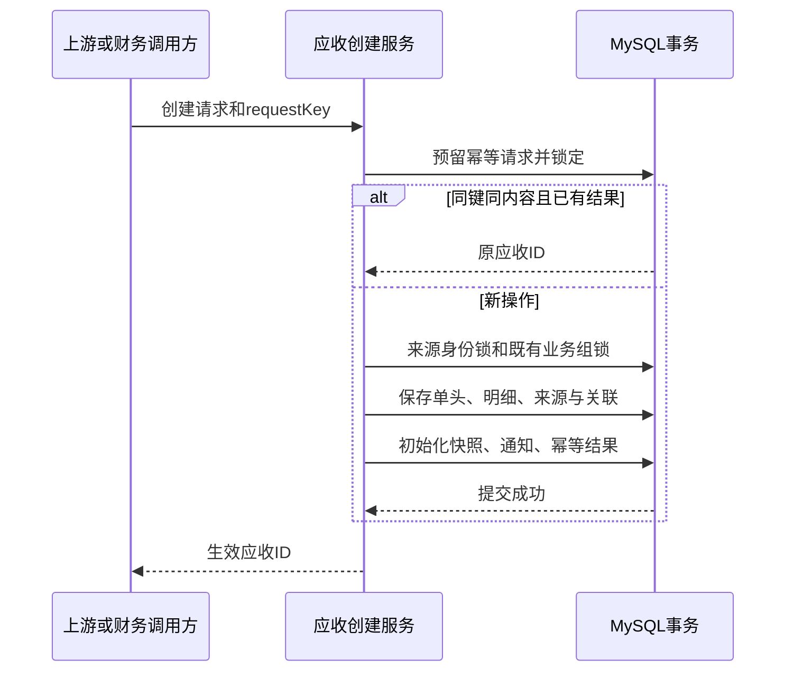
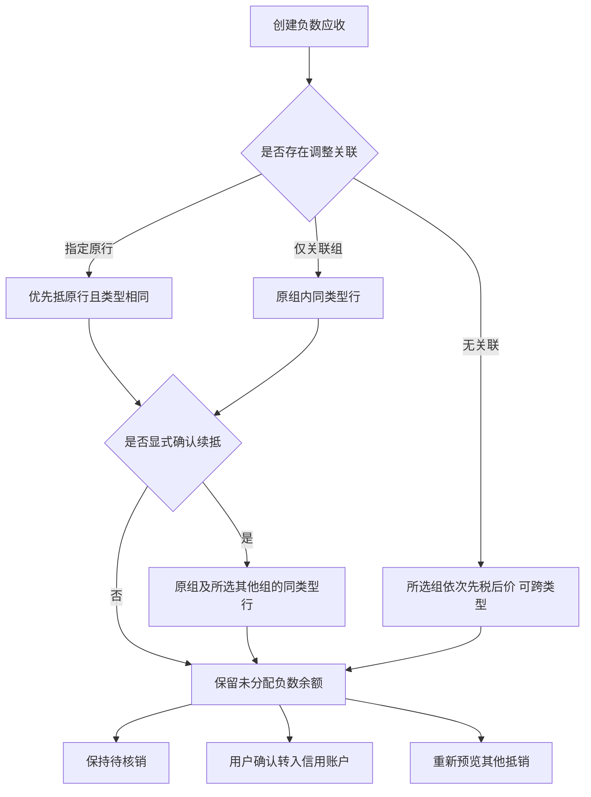
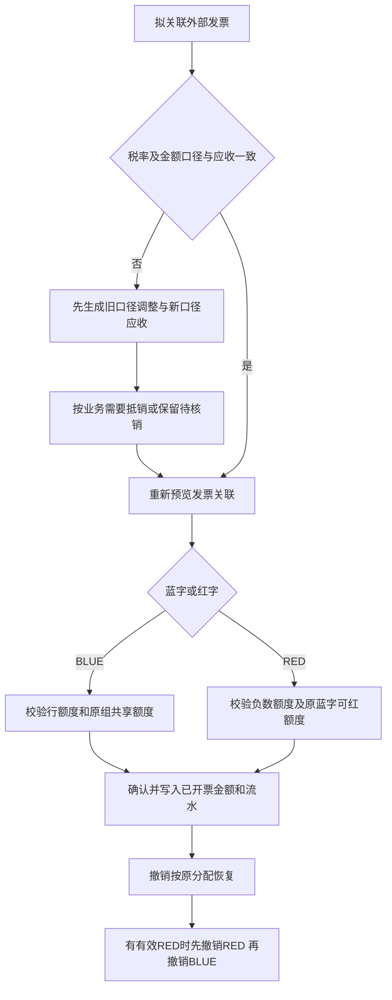
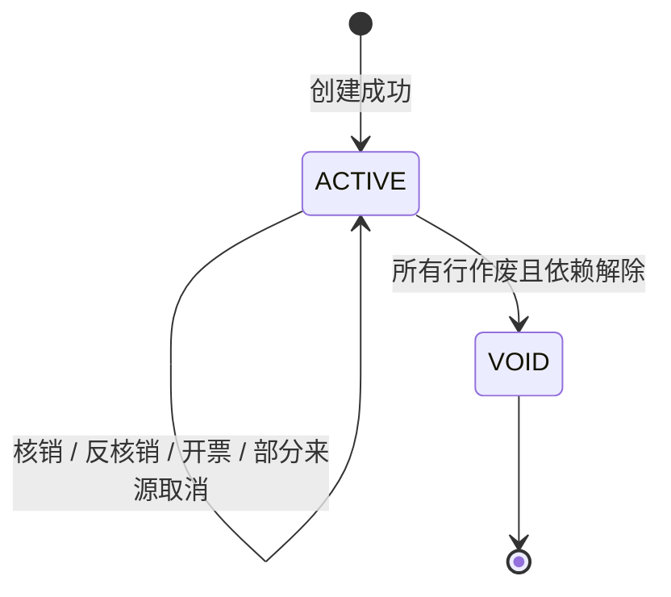

# 业务功能与流程

[返回目录](README.md) · [下一章：代码架构](02-development.md)

## 1. 业务对象与三重范围

任何资金分配、业务组关联、余额账户及开票关联均受“客户 customerId＋核算主体 legalEntityId＋结算币种 currency”约束。同客户不同主体或币种不能互抵。在已启用分户的范围内，业务组、充值批次和信用批次还受原现金账户约束。开票账户 AA 与不开票账户 AB 分别核销、冻结和提现，资金不能跨户调拨。权限按主体及动作校验；客户ID是业务归属字段，当前并无单独客户级授权模型。

| 对象 | 含义 | 容易混淆的地方 |
| --- | --- | --- |
| 应收单 document | 一次创建输出的单头，包含多行 | 单头不是唯一核销范围，同组可跨单 |
| 业务组 business_group | 需要按顺序一起处理的业务集合 | 与上游单据不强制一一对应；可仅有税额 |
| 应收行 line | 价款或税额的一条带符号债权 | 金额种类由amountType区分，不由正负号区分 |
| 来源 line_source | 原单据身份及本次事件/输出身份 | 无来源的直接录入合法，来源不是调整关联的替代品 |
| 调整关联 adjustment_link | 负数行关联的原业务组及可选原行 | 物理groupId与relatedGroupId可能不同 |
| 收款 receipt | 外部授权系统确认的实际收款登记 | 登记本身不核销应收，不调用银行 |
| 核销单 settlement | RECEIPT、OFFSET或BALANCE的一次分配确认 | 分配历史在反核销后保留 |
| 信用账户及批次 | 负数应收经用户确认转入的可用额度及来源 | 不能等同现金，不能自动退款 |
| 发票关联 invoice | 外部BLUE/RED发票及逐行应收分配 | 不生成有法律效力的税务发票 |

## 2. 金额口径与价税分离

价款使用 `PRINCIPAL`，销项税使用 `OUTPUT_TAX`。含税113可由上游拆成价款100、销项税13两行；单独收税可只生成税额行。系统没有“由含税总额自动算出两行”的创建入口，上游必须明确传入拆分结果。

每行共用五个金额字段，并通过amountType区分价款/税额，不合并业务口径：

| 字段 | 含义 | 正负规则 |
| --- | --- | --- |
| receivableAmount | 原始应收 | 允许正/负，不允许零；生成后不直接修改 |
| settledAmount | 已核销 | 与原额同方向；正负抵销分别更新双方 |
| transferredAmount | 已转入信用账户的应收金额 | 负数行转入时为负数 |
| openAmount | 未核销、未转出的余额 | ACTIVE时为原额减核销减转出 |
| invoicedAmount | 已开票关联净额 | 独立于结算；蓝字正、红字负 |

对于ACTIVE行：`openAmount = receivableAmount - settledAmount - transferredAmount`。开票金额不参与此式。负100抵销60再转信用余额30后：原额-100、已核销-60、已转出-30、剩余-10；账户增加正30。

作废行保留原额、税率、来源，open归零；作废前必须解除有效核销、转入和开票占用，因此不能用ACTIVE公式解释VOID历史行。详情按价款/税额分别汇总所有未逻辑删除行，包括VOID行保留的原额；查询当前有效应收应结合行状态，不能只看原额合计。

税率用小数表达，如13%传 `0.13`。NULL表示不适用，与零税率不同。税额行必须提供税率和计税依据；当前创建不会强制执行 `税额=计税依据×税率`，上游负责实际税额计算和舍入确认，不要把字段齐全理解为税务计算已由本系统复核。

## 3. 创建及来源防重

1. 上游提交客户、主体、币种、业务日期、业务类型、原因和明细；直接录入可无source。
2. 同一次请求中用groupKey归并新组；跨请求复用组必须传持久化groupId，groupKey不是跨请求业务唯一键。
3. 校验币种精度、价税属性、原行/原组范围及汇率依据。既有原行可以已结清，但必须仍有效且为正数。
4. 按幂等键及来源身份保护并发，创建单头、组、行、来源、调整关联、计算依据和初始化快照。
5. 成功提交即ACTIVE，open等于原额，settled/transferred/invoiced均为0，通知同步入队。

三类防重复各有用途：请求键防网络重试重复动作；来源事件＋输出键防同一业务事件重复输出；稳定来源锁防作废后换事件偷偷重建。来源eventId必须在sourceSystem内全局区分事件，outputKey必须区分该事件的每个输出（例如`line-1-principal`和`line-1-tax`），不能只用每行都相同的`tax`。

来源类型、编号、ID必填，行ID可空；无行号表示独立单据级槽，不代表全部具体行。创建请求中任何一行有来源，单头generationMode即为UPSTREAM；全部无来源才是DIRECT。

## 4. 收款登记、核销与反核销

已启用分户时，收款登记必须指定 cashAccountId，并在同一事务中创建充值批次和增加该账户账面余额。批次可用额为实收减已核销、冻结、已提现及已冲正金额。账户核销按批次顺序出资，与指定收款单核销共享这笔资金。详见[现金账户手册](../cash-accounts.md)。用户选收款、金额及有序业务组后预览，再确认。预览不冻结资金；确认时所有相关数据须仍与指纹一致。

默认组顺序由请求groupIds给出，同组先税额、后价款；持久化查询下同类行按ID升序。请求金额不得超过收款可用额。如果目标应收不足，只使用实际可分配额，多余仍留在原收款，不自动转信用账户。

示例：A组价100税13，B组价200税26，收款可用120，选择A、B：

| 顺序 | 目标 | 分配 | 分配后余额 |
| --- | --- | ---: | ---: |
| 1 | A税额 | 13 | 0 |
| 2 | A价款 | 100 | 0 |
| 3 | B税额 | 7 | 19 |
| 4 | B价款 | 0 | 200 |

不能变成先抵A税13、B税26，再抵价款81。若可用仅10，只抵A税10。

确认后保存RECEIPT核销单及逐行分配，更新收款已分配额和应收settled/open。反核销须有ar:reverse权限及原因，整单按原分配恢复；不能用当前余额重新跑分配，否则会改变历史去向。后续核销记录不受影响。

## 5. 负数调整与抵销选择

负数应收不会在创建时自动抵销。创建时指定originalLineId，或对负数指定既有groupId，将产生调整关联；只传一个新的groupKey不会自动关联其他业务。

指定原行且continueOtherTargets=false，只考虑原行；原行已结清时可分配0，不能悄悄选择别行。仅关联组时可抵该组其他同类型行。continueOtherTargets=true表示用户明确同意继续找其他目标，不放宽同类型、客户、主体、币种限制。所选额外组必须由请求明确提供，服务不会扫描全客户全部应收。

无关联负税-20，可抵所选组税5和价15；负数行仍是OUTPUT_TAX，不因资金抵销改为价款。OFFSET核销单的allocation.amount为正，positiveLineId指正应收，negativeLineId指负应收；双方settled分别增加正额和负额。

预览的unallocatedAmount表示“本次请求金额中未用部分”，remainingCredit表示“负数行总余额中本次抵销后剩余绝对值”，两者不一定相等。例如负100请求抵30、实际抵20，前者10、后者80。

## 6. 客户信用余额

转入是显式动作：选择负数行、正数转入金额、该行版本和原因。已分户时，信用账户按客户、主体、币种及来源现金账户自动创建。历史未分户范围按客户、主体和币种创建信用账户；每次转入形成一个ACTIVE来源批次，可分次转入。转入只修改来源行transferred/open、账户余额和批次，不增加settled，也不增加receipt。

余额抵扣分两层：先按业务组税后价确定目标应收分配，再按批次ID升序FIFO为这些分配提供来源。一个应收分配可来自多个批次，同一批次也可供应多个应收分配。确认生成BALANCE核销单、账户关系和批次使用明细。

撤销顺序：先撤销占用该批次的余额核销，再撤销转入。通用反核销精确回补原批次；如果批次仍被其他核销占用，即使账户总额够，也不能撤销该批次转入。转入撤销整批执行，不提供部分撤销入口。

例：转入批次L1=10、L2=25，用20抵税13和价7：税13由L1供10、L2供3，价7由L2供7；账户余15，L2已用10。反核销恢复L1的10及L2的10，不能把20全部补入最新批次。

## 7. 开票与调整链

开票额度和未收余额独立。完全收款核销不减少可开票金额；转入信用账户也不会撤销调整对开票额度的影响。

不开票账户下的应收行不贡献开票额度。开票归属键是“有效开票业务组＋价税类型＋税率”。关联负数使用relatedGroupId，其余行使用物理groupId。每个键的净剩余为有效应收带符号合计减已开票带符号合计，蓝字可用额取该值与0的较大者。还须受每行自身额度约束。

若原组税13，关联负税-4，则该组税额净应收为9；即使-4抵销到其他组或转入账户，原组仍为9，目标组的开票额度不因此减少。

实际税率/税额不一致时，先用税费调整单或上游业务形成新的调整应收，再按需核销并关联发票；不修改历史原额或税率。税率从13%改为9%的典型处理是旧税率负税-13冲回旧桶、新税率正税9进入新桶。若同时涉及价款变化，价款也要单独调整；不能只改税行却声称全部价税口径已经替换。

BLUE使用正数，RED使用负数。RED必须引用有效的同范围原BLUE及原蓝字分配，同时满足负数应收未开票额度、原蓝字剩余可红额度、类型和税率一致。关联原行的负数必须引用该原行的蓝字分配。一个外部红字行可拆分引用多个原蓝字分配。

## 8. 汇率差异

汇率差异不是只记汇兑损益的辅助记录，而是结算币种的实际应收，可正可负、可核销。businessType为EXCHANGE_DIFFERENCE，必须使用PRINCIPAL，保存原币、原额、旧新汇率、报价方向、旧新折算额及确认差额。

原币100 USD，结算CNY，旧汇率7.10、新7.30，直报价分别折算710和730，新增价款应收20。后续核销只改变结算余额，不重算历史汇率。默认不能开票；显式开启配置后仍须有计算依据。

## 9. 作废与状态

财务可按整应收单作废；上游可按精确来源槽取消，范围可跨应收单。必须先撤销有效核销、余额转入、开票关联；外部有效调整指定原行时，先处理该调整。作废不能扩大已有开票额度缺口。

作废保留原额、税率、来源和历史分配；对应稳定来源标为blocked，禁止迟到或新事件重建。上游取消先于创建到达，也会留下拦截记录。没有恢复作废或解除blocked的公开入口。

图中是单头状态；核销程度另由详情计算：UNSETTLED、PARTIAL、SETTLED、VOID。SETTLED要求所有有效行open逐条为0；正100与负100净额0但尚未抵销，仍是UNSETTLED。未达到全部有效行open为0、且任一有效行settled或transferred非零时，为PARTIAL。例如一行已完全核销、另一行完全未核销，也属于PARTIAL。开票不改变结算程度。

核销单状态POSTED→REVERSED，发票关联与余额批次ACTIVE→REVERSED；历史保留，不能当作记录被删除。

## 10. 生命周期与对账使用

每个动作保存事件、操作人、原因、关联标识、前后快照、金额增量和版本；初始化before为空。撤销事件用reverseOfId指向原事件。税率通常是不可变快照：税率变化以新增/冲回行表达，而非原地update。

应收生命周期查询只展示该单头及所属行的变化，同一事件中其他应收、账户或收款的快照不会混入。要追踪完整核销来源，应结合核销详情及批次详情；不能认为单据视图遗漏账户快照就代表没有记录。

内部对账只读地检查余额、分配、关系、初始化/最新快照，返回差异对象。不自动修账，不等于外部银行或税务对账，也不证明所有中间审计链防篡改。发现差异先定位原业务动作，不能直接修改余额使报表“归零”。
