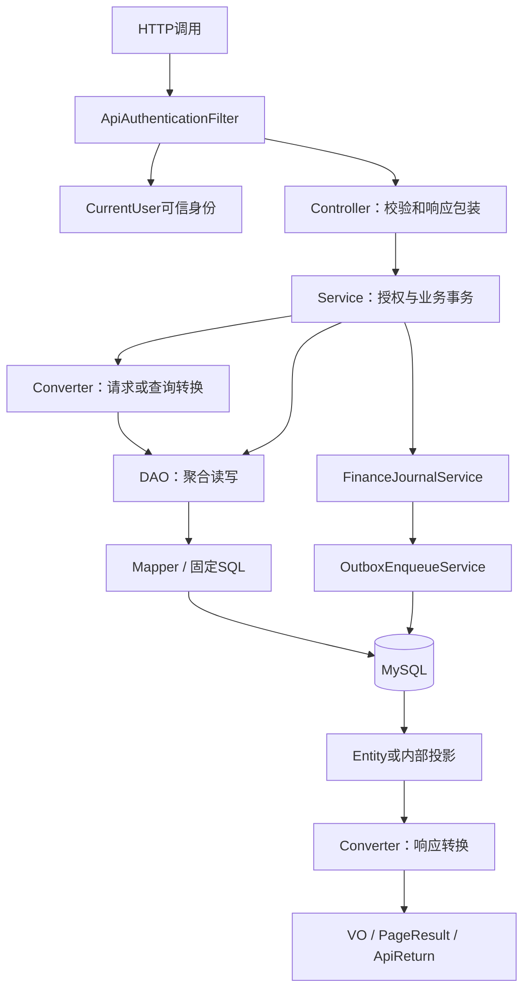
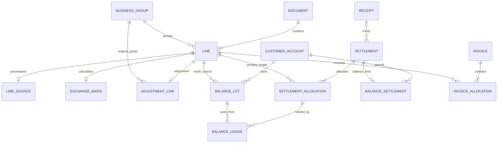
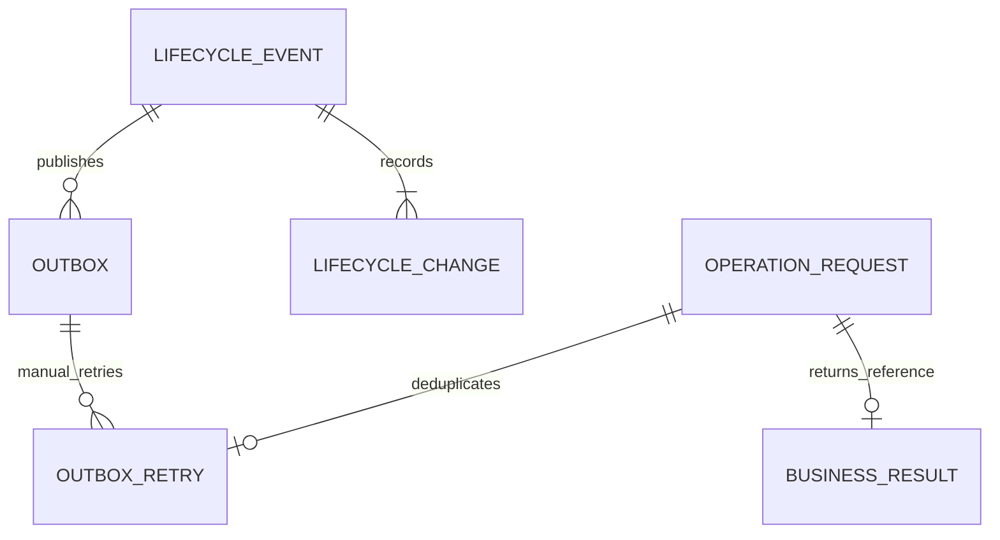

# 代码架构与数据模型

[返回目录](README.md) · [业务章节](01-business.md) · [下一章：算法与并发](03-algorithms.md)

## 1. 工程结构及阅读顺序

Maven父工程为oms-ar，业务代码全部位于oms-ar-server。包根为`com.punjab.oms.ar`。当前使用Java21、Spring Boot3.5.0、MyBatis-Plus3.5.12、MapStruct1.6.3、Flyway11.7.2；版本以[pom.xml](../../pom.xml)和[服务pom](../../oms-ar-server/pom.xml)为准。无Nacos连接，不依赖Redis完成本期财务业务。

源码入口：[Java包根](../../oms-ar-server/src/main/java/com/punjab/oms/ar)、[资源](../../oms-ar-server/src/main/resources)、[测试](../../oms-ar-server/src/test/java/com/punjab/oms/ar)。

```text
oms-ar-server/src/main/
  java/com/punjab/oms/ar/
    ArApplication.java       启动入口
    base/                    统一响应、分页、异常、CurrentUser
    config/                  凭据鉴权、MyBatis、迁移结构校验、开票/通知配置
    controller/finance/      HTTP协议适配
    service/finance/          服务接口和impl事务编排
    dao/finance/              聚合持久化接口和impl
    mapper/finance/           MyBatis实体映射及固定SQL
    domain/
      entity/finance/        持久化实体与内部查询投影
      dto/finance/           写入/业务动作请求
      query/finance/         只读查询请求
      bo/finance/            内部查询及计算对象
      vo/finance/            对外只读响应
      convert/finance/       MapStruct转换器
    common/utils/            金额、汇率、快照等工具
    enums/                   金额类型、策略及方向
    extapi/                  外部通知客户端
  resources/
    application.yml          环境变量配置
    db/migration/            V001—V012正式迁移
    db/schema-contract.json  实际表结构摘要基准
```

复杂固定SQL当前主要位于Java Mapper及DAO代码，不要根据工程规范中的历史示例寻找本仓库并不存在的Mapper XML目录。



Controller不依赖DAO或Entity；Service接口不暴露Entity；Query必须转为BO再进入DAO；DTO/Query/VO用途分开。当前finance内存在跨实体聚合事务，允许同一finance服务使用本模块聚合DAO；跨其他业务模块仍须经过对方Service。

## 2. 服务职责与定位地图

下表名称均位于[service/finance/impl](../../oms-ar-server/src/main/java/com/punjab/oms/ar/service/finance/impl)。接口同名去掉Impl。

| 实现类 | 核心责任 | 主要持久化协作 |
| --- | --- | --- |
| ReceivableServiceImpl | 创建、生效、来源锁、原行调整、汇率依据、初始化 | ReceivableDao、OutboxEnqueueService |
| ReceivableQueryServiceImpl | 详情、价税汇总、结算程度及分页 | ReceivableDao |
| AllocationServiceImpl | 无数据库副作用的组内税后价分配 | 纯BigDecimal计算 |
| ReceiptServiceImpl | 实收登记与详情 | ReceiptDao、FinanceJournalService |
| SettlementServiceImpl | 收款核销、通用反核销路由、OFFSET撤销 | SettlementDao、BalanceSettlementService |
| OffsetServiceImpl | 关联或独立负数抵销 | SettlementDao、ReceivableDao |
| CustomerBalanceServiceImpl | 转入、撤销转入、账户/批次详情 | CustomerBalanceDao、ReceivableDao |
| BalanceSettlementServiceImpl | FIFO来源分摊、余额核销及原批次恢复 | BalanceSettlementDao、CustomerBalanceDao、SettlementDao |
| InvoiceEligibilityServiceImpl | 原组/类型/税率开票容量 | InvoiceEligibilityDao |
| InvoiceServiceImpl | BLUE/RED预览、登记、详情、撤销 | InvoiceDao、InvoiceEligibilityService |
| ReceivableVoidServiceImpl | 财务/上游作废与来源blocked | ReceivableVoidDao、ReceivableDao |
| FinanceJournalServiceImpl | 幂等预留/完成、事件与快照、入队 | ReceivableDao、OutboxEnqueueService |
| LifecycleServiceImpl | 单据视角生命周期分页 | LifecycleDao |
| SettlementQueryServiceImpl | 核销单和分配/批次使用详情 | SettlementQueryDao |
| FinancePageServiceImpl | 核销单、账户、批次分页 | FinancePageDao |
| ReconciliationServiceImpl | 只读内部差异报告 | ReconciliationDao |
| OutboxEnqueueServiceImpl | 将完整事件及变化组成不可变通知 | OutboxDao |
| OutboxLeaseServiceImpl | 短事务领取、续处理结果CAS | OutboxLeaseDao |
| OutboxDispatchServiceImpl | 无事务网络发送、退避与逐主体隔离 | OutboxLeaseService、外部HTTP客户端 |
| OutboxQueryServiceImpl | 通知元数据分页和payload详情 | OutboxQueryDao |
| OutboxRetryServiceImpl | 失败通知人工重试及独立审计 | OutboxRetryDao、FinanceJournalService |

阅读一个动作时按“Controller→请求DTO→Service→DAO/Mapper→迁移约束→对应RealTest”追踪。只读Service判断不了SQL是否有主体条件，必须检查DAO；只看DDL也无法证明跨表金额守恒。

## 3. 数据模型：实际21张表

下表省略统一前缀`oms_ar_`。正式文件位于[db/migration](../../oms-ar-server/src/main/resources/db/migration)。金额DECIMAL(24,8)、税率DECIMAL(12,8)、汇率DECIMAL(24,12)；业务金额还需符合币种实际小数位。每表主键为BIGINT自增，统一六个审计字段：id/created_time/created_by/updated_time/updated_by/delete_status。

| 表 | 版本 | 关键字段/关系 | 设计目的 |
| --- | --- | --- | --- |
| document | V001 | doc_no、范围、business_type、日期、状态、version、作废原因/人/时间 | 应收单头及作废记录 |
| business_group | V001 | group_no、范围、日期、version | 跨单分组及并发共同锁对象 |
| line | V001 | document_id、group_id、line_no、amount_type、五金额、税率/依据、状态/version | 当前明细投影 |
| line_source | V001 | line_id、system/type/no/id/line_id、event_id/output_key、original_line_id | 每行最多一份来源，事件输出防重 |
| operation_request | V002 | 主体、caller_id、operation_type、request_key、payload_hash、result_reference | 写动作幂等结果 |
| lifecycle_event | V002 | 类型、双时间、actor、reason、trigger、correlation、reverse_of_id、schema_version | 不可变事件头 |
| lifecycle_change | V002 | event_id、对象类型/ID、before/delta/after、前后version | 对象级快照 |
| receipt | V003 | 范围、amount、allocated_amount、来源、received_date、version | 实际收款与分配占用 |
| settlement | V004 | 类型、receipt_id、范围、amount、strategy、fingerprint、status、version | 核销单；receipt_id仅收款型使用 |
| settlement_allocation | V004 | settlement_id、sequence_no、positive_line_id、negative_line_id、amount_type、amount | 正数分配金额与双方应收 |
| adjustment_link | V005 | line_id、related_group_id、original_line_id | 负数的原组与可选原行，不随资金去向变化 |
| customer_account | V006 | 范围、balance_amount、version | 信用可用余额，三重范围唯一 |
| balance_lot | V006 | account_id、source_line_id、范围、amount、used_amount、status、version | 一次转入一个批次 |
| balance_settlement | V007 | settlement_id、account_id | BALANCE核销对应账户 |
| balance_usage | V007 | settlement_id、allocation_id、lot_id、sequence_no、amount | 应收分配与来源批次多对多桥接 |
| invoice | V008 | 来源、invoice_no/date、范围、kind、original_invoice_id、total_amount、状态/version | 外部发票关联头 |
| invoice_allocation | V008 | 发票/外部行/应收行、amount_type、amount、tax_rate、original_allocation_id | 带符号蓝红分配，红字追溯原蓝分配 |
| exchange_basis | V009 | line_id、原币/额、旧新汇率/折算额、方向、confirmed_difference | 不可变汇率计算依据 |
| source_guard | V010 | 主体、source_key、原身份、blocked、version | 来源取消与迟到生成串行化 |
| outbox | V011 | event_id、主体、destination、payload、status、attempt、时间、租约、version | 业务原子入队、可变派发投影 |
| outbox_retry | V012 | outbox_id、operation_id、reason、前后状态/次数/时间/错误/version | 人工重试不可变运营审计 |

不存在独立balance_transfer或balance_entry表：转入由balance_lot承载，金额变化由lifecycle_change承载。也没有把lot_id直接放在settlement_allocation上，因为一条应收分配可能使用多个批次。



此图省略负数行、原蓝字/原分配的自引用及部分复合外键，便于阅读；字段和强制约束以DDL为准。来源防重和流水对象ID也不能一概当作FK。

## 4. 不变量及数据库兜底

- ACTIVE行：open=receivable-settled-transferred；核销/转出不得越过原额方向，不能跨零。
- VOID行open为0；实际依赖是否解除由服务查有效关系及金额共同判断。
- 信用账户不能为负；每个ACTIVE批次0≤used≤amount；账户余额等于有效批次未用额之和。
- 每笔核销的分配金额合计等于单头amount；BALANCE分配还应等于对应balance_usage合计。
- BLUE正额、RED负额；RED指向原BLUE及原分配；原蓝字可红额受有效红字累计约束。
- 逻辑删除统一显式过滤，没有@TableLogic自动过滤；业务VOID/REVERSED与delete_status不同。

唯一键承担最终竞争兜底：

| 场景 | 实际唯一范围 |
| --- | --- |
| 创建/动作重放 | legal_entity_id＋caller_id＋operation_type＋request_key |
| 来源业务事件输出 | source_system＋source_event_id＋source_output_key（不含主体） |
| 来源取消身份 | legal_entity_id＋source_key；source_key为system/type/id/lineId数组摘要 |
| 收款来源 | legal_entity_id＋source_system＋source_id |
| 发票来源 | legal_entity_id＋source_system＋source_id，撤销后不复用 |
| 客户信用账户 | customer_id＋legal_entity_id＋currency |
| 通知 | event_id＋destination |
| 人工重试审计 | operation_id唯一，outbox_id＋before_version唯一 |

同一上游sourceSystem下跨客户/主体也必须使用不冲突的eventId/outputKey。不要误认为传了legalEntityId就自动进入另一来源事件命名空间。

## 5. 审计与通知模型



BUSINESS_RESULT是概念节点，不是实际表。operation_request.result_reference依据动作指向不同结果：创建为应收ID、核销为核销ID、转入为批次ID、开票为关联ID、作废为事件ID、人工重试为重试审计ID。调用方应按接口语义解析。

| 事件类型 | 发生时机 |
| --- | --- |
| CREATED | 应收创建及关联对象初始化 |
| RECEIPT_CREATED | 实收登记 |
| RECEIPT_SETTLED / OFFSET_SETTLED / BALANCE_SETTLED | 三类核销确认 |
| SETTLEMENT_REVERSED | 三类核销逆向恢复 |
| BALANCE_TRANSFERRED / BALANCE_TRANSFER_REVERSED | 信用转入/撤销转入 |
| INVOICE_REGISTERED / INVOICE_REVERSED | 发票关联/撤销 |
| RECEIVABLE_VOIDED | 财务或上游作废，包括来源拦截 |

普通业务调用FinanceJournalService.begin→append→complete，均加入外层事务（MANDATORY）。创建有自己的初始化编排，但同样使用版本2快照并同事务入队。人工重试使用begin/complete及outbox_retry，不调用append，避免“重试通知又产生一条通知”的递归。

schemaVersion=2的快照把JSON小数转换成十进制文本，整数保留数值，避免MySQL JSON对大精度小数的浮点舍入。before/delta/after是JSON结构；金额字段读取端要接受版本1数值和版本2字符串。原快照不重写，已丢失精度无法事后补回。业务DECIMAL和幂等请求摘要序列化不随快照格式转换。

审计只通过业务接口追加，不开放任意更新/删除；这并不等于数据库管理员无法篡改。outbox.status可变，是派发运行状态，不能拿它替代不可变业务事实。

## 6. 新增功能的开发步骤

1. 在业务手册写清触发、范围、前置条件、金额方向、撤销及幂等结果；查现有服务能否复用。
2. 定义DTO或Query以及VO，不接受客户端传入actor、已核销额、余额或任意状态；在服务层再次验证参数和授权。
3. 先补失败用例，再写实现。金额、锁、外键及事务必须有真实MySQL门禁测试；纯算法用默认JUnit测试。
4. Service开启写事务，先预留幂等操作，再按已有顺序锁聚合；读取后重验，CAS零行即冲突回滚。
5. 显式维护审计六字段；将业务关系、余额、前后快照、通知与幂等结果置于同一事务。
6. 若新增结构，追加新V版本，不编辑已发布V001—V012；更新结构契约、迁移/漂移测试和实际表清单。
7. DTO/Query经Converter到Entity/BO；DAO不返回Web VO，不自行开启业务事务；跨模块通过Service交互。
8. 运行相应定向测试、默认测试及必要实库/启动回归，通过后同步手册并独立Git提交。

新建Java类Javadoc作者统一Punjab。HTTP只使用GET/POST，POST使用对象请求体；Controller返回ApiReturn，分页PageResult。SQL JOIN、聚合、数据库时间和CAS允许固定SQL扩展，但不能用客户端字段拼接列名或排序。

## 7. 扩展时必须保留的语义

- 新业务类型：当前businessType大多是业务标签，EXCHANGE_DIFFERENCE有专门规则；新增特殊行为不能只加字符串而遗漏验证、额度资格和快照。
- 新核销策略：同步三个预览/确认路径，保持用户确认指纹、反核销原分配不变；不能仅让枚举值通过验证。
- 新税率：新建调整及新口径行，不提供原行税率update。
- 新币种：Currency小数位、DECIMAL范围、汇率舍入和开票/余额范围都要验证；跨币种抵销不是“放开字段校验”即可完成。
- 新鉴权：身份须由可信认证层提供，保留CurrentUser清理和服务层主体/权限检查；caller_id实际取username，更换调用方身份会改变幂等命名空间。
- 新通知目的地：需重新审查事件/目的地唯一性、接收配置、权限、租约、人工重试以及去重键；首期实现固定FINANCE_EVENTS。
