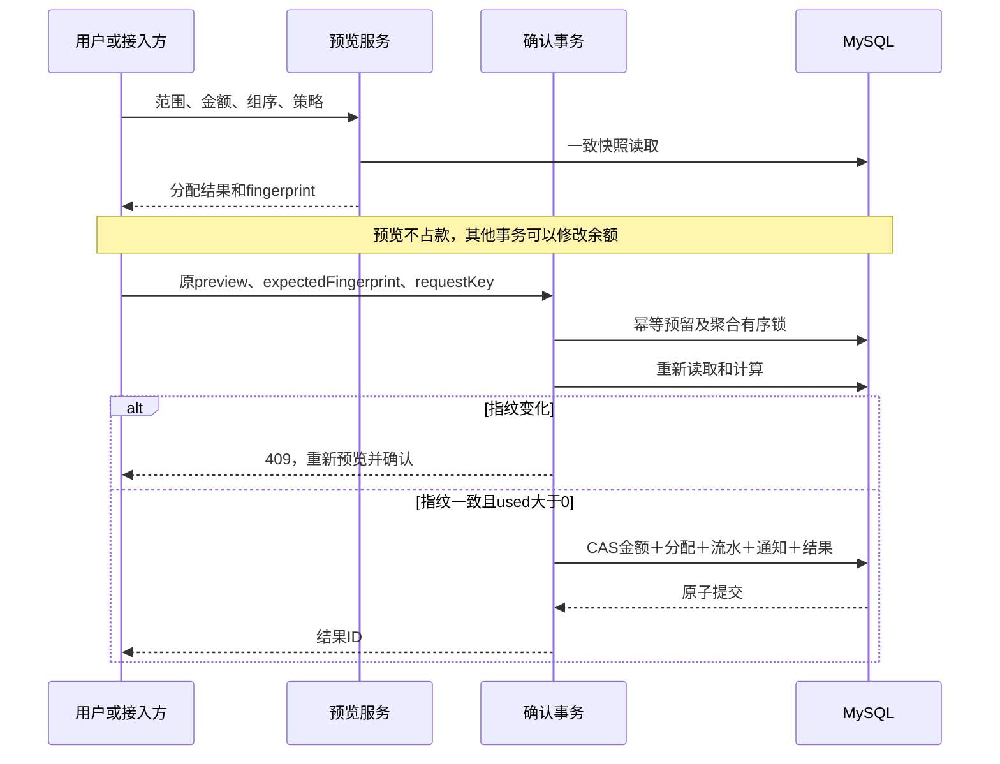
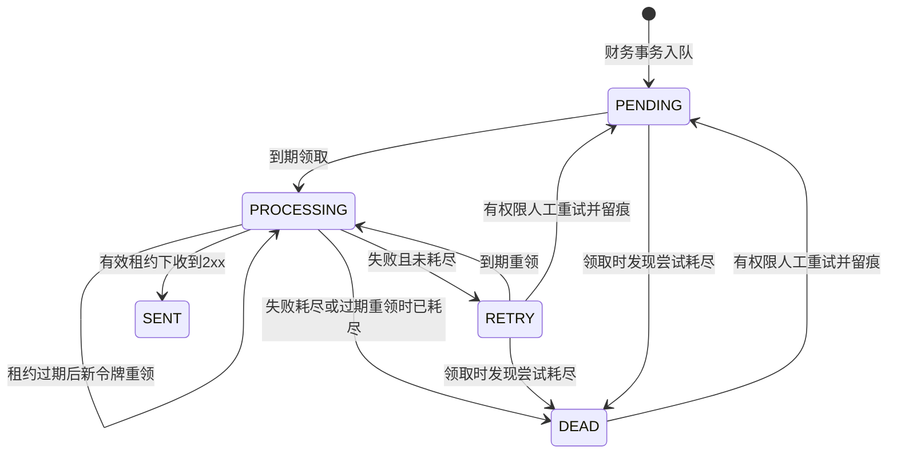

# 关键算法与事务并发

[返回目录](README.md) · [上一章：代码架构](02-development.md) · [下一章：接入运维](04-integration-operations.md)

## 1. 金额与精度基础

计算使用BigDecimal，禁止double参与金额。金额数值比较使用compareTo，不能用equals判断业务相等（1.0与1.00的scale不同）。原额及计算值绝对值需小于10^16，最多8位小数；实际入账受Currency.getDefaultFractionDigits限制，例如CNY两位、JPY零位。未知或不支持的小数位币种拒绝。

一般金额用setScale(currencyScale, UNNECESSARY)验证，超精度拒绝，不默默舍入。汇率折算是已明确定义的例外，使用HALF_UP。税率数值比较用FinanceValues.sameTaxRate，NULL与0不同；额度分桶前stripTrailingZeros，使0.13与0.1300进入同桶。

来源：[FinanceValues](../../oms-ar-server/src/main/java/com/punjab/oms/ar/common/utils/FinanceValues.java)、[AllocationServiceImpl](../../oms-ar-server/src/main/java/com/punjab/oms/ar/service/finance/impl/AllocationServiceImpl.java)。

## 2. 组内先税后价的分配算法

输入：可用金额A、币种精度、有序业务组及每行类型/余额。输出：有序分配列表和未分配金额。不修改输入对象、不访问数据库、不接受负数目标；负数应收由抵销服务作为资金来源处理。

```text
先校验全部组和行：ID有效、无重复、金额非负、精度和上限合法
remaining = A
for group in 请求给定顺序:
    for type in [OUTPUT_TAX, PRINCIPAL]:
        for line in group.lines的输入顺序:
            若类型不匹配或remaining为0：跳过
            allocated = min(remaining, line.openAmount)
            若allocated > 0：追加分配，remaining -= allocated
return 分配列表, remaining
```

即使资金已分完，也先验证后续所有目标，避免非法行被提前退出隐藏。纯算法保留同类行输入顺序；持久化服务通过DAO按ID升序取行，再按请求组序组装输入。数据库加锁组ID顺序不等于业务分配组顺序，不能混为一谈。

纯算法对N行进行校验和两次类型扫描，时间O(N)，输出空间O(N)。服务端组装时可能按每个组扫描行集合，不能把整个接口都宣称为O(N)。请求限制组数不等于限制组内历史行总量；大组吞吐需另外测量。

守恒：`sum(allocations)+unallocated=A`；每行分配≤该行open；没有0金额分配。确认不允许usedAmount为0。

## 3. 关联负数抵销目标构造

来源：[OffsetServiceImpl](../../oms-ar-server/src/main/java/com/punjab/oms/ar/service/finance/impl/OffsetServiceImpl.java)。负数来源必须ACTIVE且原额<0，请求amount为正且≤负数open绝对值。

```text
读取负数行及不可变adjustment_link
targetGroups = [关联原组（若有）] + 用户选择的组（去重保持顺序）
取得所有相关物理组的有序锁，再锁负数行、加载目标正数行
若有关联且未确认continueOtherTargets，拒绝额外所选组
ordered = 原行（若指定且仍为候选）
依targetGroups逐组追加：
    关联负数：仅同amountType
    指定原行且未确认续抵：不追加其他行
    其余：税额优先，同类型按行ID
按min(remaining, target.open)依次分配
```

这一步不要求抵销目标税率与负数税率相同：当前资金抵销的关联约束是“同类型”；开票口径的税率归属另行处理。指定原行的负数在创建时必须与原行税率相同，不能将两条规则混淆。

确认对正行执行settled+=a、open-=a，对负行执行settled-=used、open+=used。撤销反向应用持久化allocation，不再寻找目标。原组税3、另一组税26、关联负税-10并确认续抵时：原组抵3、另一组抵7；开票原组净额为-7，另一组仍为26。

## 4. 信用余额FIFO与守恒

来源：[BalanceSettlementServiceImpl](../../oms-ar-server/src/main/java/com/punjab/oms/ar/service/finance/impl/BalanceSettlementServiceImpl.java)。先验证请求额≤账户余额，并验证有效可用批次合计等于账户余额。不一致时拒绝，要求对账。

第一层调用组内税后价算法得到目标分配。第二层使用双指针：

```text
lots = ACTIVE且有未用金额的批次，ID升序
lotIndex = 0
for targetAllocation in 目标分配顺序:
    need = targetAllocation.amount
    while need > 0:
        若当前批次余量=0：移向下一批次
        use = min(need, 当前批次余量)
        保存(lineId, lotId, use)
        need -= use; 批次余量 -= use
```

FIFO按自增批次ID，不按业务日期或用户填写时间。实际写入时按批次聚合use后更新used_amount，账户扣实际usedAmount。拆分阶段扫描目标与批次，复杂度与实际目标、批次数及输出明细数线性相关。

三个守恒式必须同时成立：

- account.balance = Σ ACTIVE lot(amount-used)。
- 每条settlement_allocation.amount = Σ该allocation的balance_usage.amount。
- settlement.amount = Σ原分配amount = Σ原usage.amount。

撤销先读取原allocation和usage，校验合计及账户/批次范围，再回补相同批次；后续不同核销的占用保留。来源负数的transferred_amount不会因余额被使用或反核销而变化，仅转入/撤销转入改变。

## 5. 开票容量、红字约束及税率替换

来源：[InvoiceEligibilityServiceImpl](../../oms-ar-server/src/main/java/com/punjab/oms/ar/service/finance/impl/InvoiceEligibilityServiceImpl.java)、[InvoiceServiceImpl](../../oms-ar-server/src/main/java/com/punjab/oms/ar/service/finance/impl/InvoiceServiceImpl.java)。

对每条有效行定义：

```text
invoiceGroup = adjustment.relatedGroupId（有关联）否则line.groupId
bucketKey = (invoiceGroup, amountType, normalizedTaxRate)
R(bucket) = Σ该桶有效且支持开票行的receivableAmount
I(bucket) = Σ该桶相同行的invoicedAmount
remaining(bucket) = R - I
blueAvailable(bucket) = max(remaining, 0)
lineRemaining = receivableAmount - invoicedAmount
```

汇率差异默认不支持开票，开启后仍需依据。原行关联的历史类型/税率若不一致，拒绝计算，而不是静默忽略坏数据。收款/核销/转余额/open均不进入公式。

BLUE登记逐行聚合本次amount，检查不超正行自身剩余；再按bucketKey聚合，检查不超共享blueAvailable。只校验行剩余会使“正100＋关联负20”的正行仍可开100，错误多开20，所以必须双重约束。

RED：

1. 原发票是同客户/主体/币种有效BLUE，originalAllocationId确实属于该BLUE。
2. 红字负数应收与原蓝分配类型、税率一致；有关联组/原行时符合指定归属。
3. 本次同负数行累计红字绝对值≤该行剩余负数额度绝对值。
4. 同原蓝字分配的本次累计红字绝对值≤原amount−已有有效红字绝对值累计。
5. totalAmount与所有本次带符号分配合计相等。

负桶额度不直接等于可开红字额度，仍须合法原蓝分配。撤销RED可能再次造成原组净剩余额为负，这是撤销历史关联的结果；后续BLUE依旧受当前共享额度限制。

## 6. 汇率差额算法

来源：[ExchangeDifferenceCalculator](../../oms-ar-server/src/main/java/com/punjab/oms/ar/common/utils/ExchangeDifferenceCalculator.java)。设原额M、旧新汇率r0/r1、结算币种精度s：

```text
SETTLEMENT_PER_ORIGINAL:
    old = HALF_UP(M*r0, s)
    new = HALF_UP(M*r1, s)
ORIGINAL_PER_SETTLEMENT:
    old = divide(M, r0, s, HALF_UP)
    new = divide(M, r1, s, HALF_UP)
difference = new - old
```

必须“分别折算舍入，再相减”，不能先计算汇率差再一次舍入。例M=1、r0=1.004、r1=1.006、s=2：正确差额1.01−1.00=0.01；先减汇率0.002再舍入得到0.00，结果不同。行amount必须精确等于difference，零差额不生成应收。

原币与结算币不能相同，汇率必须正，原额非零并符合原币精度，折算和差额都不能溢出。原额可以为负，由符号自然生成差额；不能取绝对值后丢失方向。

## 7. 请求幂等与预览指纹是两道不同保护

幂等键唯一范围为主体、可信actor（caller_id）、动作、requestKey；payload_hash为序列化请求的SHA-256。insert-on-duplicate no-op并锁行，使同键并发串行化；同键异内容冲突，同键同内容已完成则返回原result_reference。

这是请求表示级摘要，不是任意JSON业务语义归一化：重新排序列表、变更原因或金额序列化精度可能改变摘要。网络重试应保存并重发同一请求，不要在重试时重建另一个含随机值的内容。同一业务如果改内容，应使用新requestKey；来源唯一键仍会阻止重复创建输出。

预览指纹则保护“用户看到的分配与确认时仍一致”。典型输入：

| 动作 | 参与指纹的关键内容 |
| --- | --- |
| 收款核销 | 原preview请求、收款对象、候选正数行集合 |
| 负数抵销 | 原请求、负数行、调整关联、候选正数行集合 |
| 余额核销 | 原请求、账户、可用批次、候选正数行集合 |
| 开票 | 原请求、当前源行/共享额度、原蓝字及相关分配状态 |

具体序列化组合以load方法为准，指纹是不透明版本令牌，不由前端自己计算。组内补税会改变成员集合；即使某行open没变，其他动作更新version也可能使指纹失效。



确认回滚时不能留下完成的幂等结果、半张核销单或孤立通知。服务层不自动替用户接受新分配。

## 8. 锁顺序、隔离级别及CAS

以下列的是完成幂等请求预留后的主要业务锁，初始定位用普通读不等于提前加锁。多来源按摘要排序，多组按ID升序，多行/批次按稳定顺序；分配顺序仍按用户选择。

| 路径 | 主要锁顺序 |
| --- | --- |
| 创建 | 稳定来源→既有组→指定原行；新单及新组在本事务创建 |
| 收款核销确认 | 收款→有序组→目标行 |
| OFFSET确认 | 负数相关物理组及目标组→负数行→目标正数行 |
| RECEIPT/OFFSET反核销 | 原核销单→收款（若有）→组→原分配双方行 |
| 转信用余额 | 账户预留/锁定→来源组→负数行→新增批次 |
| 撤销转入 | 账户→原批次→来源组→负数行 |
| 余额核销 | 账户→可用批次→组→目标行 |
| 余额反核销 | 原核销单→账户→原使用批次→组→原目标行 |
| 发票登记 | RED先原BLUE；之后有效开票业务组锁与重读、行CAS |
| 发票撤销 | RED先原BLUE→本发票→开票业务组→原行CAS |
| 作废 | 来源→单头→有序物理/开票组→行，重验依赖 |
| 人工重试 | 幂等请求→通知行，CAS和审计 |

业务组是跨单共享额度、组成员变化与作废竞争的协调点；只锁某条行不能保护整个组。这里是当前调用顺序摘要，修改时仍须检查实际DAO执行SQL及所有逆向路径，不能将表格当作无死锁的数学证明。

查询涉及多表计数/详情通常使用readOnly REPEATABLE_READ，保证返回头、明细、汇总来自同一快照；单对象查询可不启事务。普通写事务使用默认隔离，关键读走FOR UPDATE。发票登记/撤销、作废及通知租约/重试显式READ_COMMITTED，取得共同锁后再读最新状态。

更新条件包含id、expectedVersion及必要状态/delete_status；version加一并写updatedBy/Time。影响行数不是1即抛错回滚。行锁用于竞争协调，CAS用于防旧版本和异常并发写入，二者不能互相替代。遇到锁超时/死锁，不保证自动服务端重试；接入方先确认事务结果，再以原请求键安全重试或重新预览。

## 9. 作废的共享额度保护

作废不仅检查当前settled/transferred/invoiced非零，还查有效settlement、balance_lot、invoice等关系，避免投影被破坏后误放行。对原行有外部有效负数调整引用的场景，不允许孤立调整。

按每个受影响开票桶比较作废前后的净缺口；不能删除未开票正数后让已有开票净额超过剩余有效应收，不能扩大已有负缺口。通过后只将行status设VOID/open设0，单头全部行VOID时才置VOID；来源blocked变化和业务状态在同一事务。失败时来源不能先blocked而应收仍半生效。

## 10. 对账重算规则

对账在必选主体、客户、币种范围内使用RR快照，同一差异SQL用于count和page，固定按rule/objectId排序。不写任何财务数据。当前21类规则如下：

| 类别 | 规则 | 重算或判定依据 |
| --- | --- | --- |
| 明细金额 | LINE_SETTLED | 有效核销分配，正行加正额、负行加负额 |
| 明细金额 | LINE_TRANSFERRED | 有效转入批次金额取负方向 |
| 明细金额 | LINE_INVOICED | 有效发票带符号分配 |
| 收款 | RECEIPT_ALLOCATED | 有效RECEIPT核销合计 |
| 账户 | ACCOUNT_BALANCE | ACTIVE批次amount-used |
| 批次 | LOT_USED | 有效BALANCE核销使用记录 |
| 历史结构 | SETTLEMENT_TOTAL | 原单头与原分配合计，包含REVERSED历史 |
| 历史结构 | BALANCE_ALLOCATION_USAGE | 每条分配与原usage合计 |
| 历史结构 | INVOICE_TOTAL | 原发票单头与带符号分配合计 |
| 红字上限 | INVOICE_RED_EXCESS | 有效红字累计绝对值不得超原蓝分配 |
| 当前投影 | LINE_OPEN | ACTIVE恒等式或VOID余额0 |
| 作废占用 | LINE_VOID_OCCUPANCY | 作废行不得有核销/转入/开票占用 |
| 快照 | LINE_AUDIT_INITIAL | 初始化存在且原额、类型、税属性和归属一致 |
| 快照 | LINE_AUDIT_LATEST | 最新有效快照版本、状态、金额及不变属性一致 |
| 关联 | INVOICE_RELATION | 发票分配范围、类型、税率、方向、状态 |
| 关联 | ADJUSTMENT_RELATION | 负数与原组/原行范围及价税属性 |
| 关联 | SETTLEMENT_RELATION | 双方范围/方向，关联负数同类型，独立可跨类型 |
| 父对象 | LINE_PARENT | 单头/业务组存在、未删除、范围与状态相容 |
| 来源 | LINE_SOURCE_MISSING | 以初始化SOURCE证据判断来源丢失，不误报直接录入 |
| 批次使用 | BALANCE_USAGE_RELATION | usage、allocation、lot、account范围与有效状态 |
| 红字引用 | INVOICE_RED_RELATION | 原BLUE、原分配及调整引用正确 |

上表为21个规则名称；历史“22项对账实库测试”是测试方法数量，不是规则数。金额差异返回storedAmount与expectedAmount；结构/布尔异常常用1与0，不能把所有差异都相加成货币差额。正常已撤销关系允许保留，不因其父业务已撤销而一律报错。无差异仍不保证全部中间事件连续性、外部系统一致性或管理员无法改库。

## 11. 通知投递与人工重试算法

业务事务内保存一份不可变payload，含事件及完整变化，逻辑目的地固定FINANCE_EVENTS。初次next_attempt_at及租约、重试、发送时间使用数据库时钟，避免应用与数据库时区差异造成初次延迟。



领取使用短事务及FOR UPDATE SKIP LOCKED；attempt_count每次领取加一，新UUID leaseToken防旧工作者覆盖新工作者。达到最大次数的待处理记录可直接置DEAD，本轮返回空，不代表后面永远没有可发消息。

网络发送在NOT_SUPPORTED方法中，领取与结果确认是REQUIRES_NEW短事务。结果CAS匹配ID、主体、目的地、PROCESSING、token及未过期租约；即使尚未重领，过期工作者也不能确认成功。

退避：`min(retryBaseSeconds * 2^(attempt-1), retryMaxSeconds)`，默认5、10、20、40、80、160、320…秒，最多8次，最大间隔3600秒。计算以迭代倍增避免指数溢出。总请求超时默认3秒，租约默认30秒，校验要求至少多5秒。

如果远端已处理但本地确认前崩溃，下次仍会重复发送。接收端必须按`ar-{legalEntityId}-{eventId}-{destination}`持久化去重后返回2xx。3xx不跟随，4xx/5xx也进入有限重试；错误只记录状态或分类，不存正文/凭据。

人工重试仅允许RETRY/DEAD且expectedVersion匹配，重置PENDING、attempt=0、数据库当前调度时间及错误，追加outbox_retry并保存幂等结果。不允许人工抢占PROCESSING（即使已过期）、重复重置PENDING或重发SENT，不修改payload或财务余额；失败历史通过重试审计保留。
