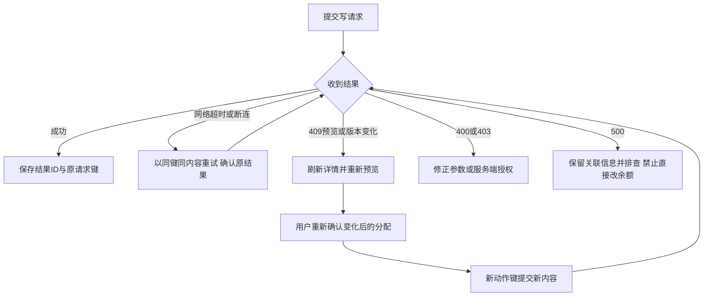
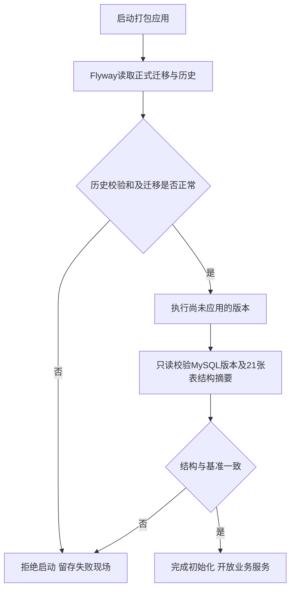

# 接口接入、运行与验证

[返回目录](README.md) · [上一章：算法与并发](03-algorithms.md)

## 1. 通用协议与权限

接口前缀`/api/finance`，统一响应`{code,data,msg}`，成功code=0。分页data为`{total,page,size,records}`，页号从1开始，默认size=20，最大200。HTTP状态：401凭据缺失/无效，403主体或动作越权，400参数/格式错误，409业务冲突，500内部错误（不返回SQL细节）。不要只根据HTTP成功就忽略业务响应。

所有请求携带`Authorization: Bearer <受保护凭据>`，POST还需`Content-Type: application/json`。服务不接受X-User自报身份；actor由服务端凭据配置映射。当前是调用方凭据，不是终端用户登录系统；多用户操作应由可信身份适配层提供独立身份，不能让前端自己填写审计人。

| 权限 | 可执行行为 |
| --- | --- |
| ar:create | 创建应收 |
| ar:read | 应收/收款/核销/账户/批次/发票/生命周期/对账查询 |
| ar:receipt:create | 登记实收 |
| ar:settle | 收款、负数抵销、余额抵扣的预览与确认 |
| ar:balance:transfer | 负数转信用余额 |
| ar:invoice:write | 发票关联预览和登记 |
| ar:reverse | 反核销、撤销转入、撤销发票关联 |
| ar:void | 财务整单作废 |
| ar:void:upstream:系统名 | 指定来源系统的上游作废，精确匹配 |
| ar:outbox:read | 通知分页/详情/人工重试历史 |
| ar:outbox:retry | 失败通知人工重试 |

每项仍需legalEntityId在服务端授权主体集合内。普通ar:read不授予通知原文读取，ar:create不自动授予收款登记或作废。默认只有ar:create、ar:read；测试或联调需要的权限应由环境配置明确增加。

## 2. 完整业务路由索引

下表路径省略`/api/finance`；写入对象字段详见[DTO目录](../../oms-ar-server/src/main/java/com/punjab/oms/ar/domain/dto/finance)，只读条件见[Query目录](../../oms-ar-server/src/main/java/com/punjab/oms/ar/domain/query/finance)。所有POST都是对象请求体。

| 资源 | 方法和路径 | 结果/用途 |
| --- | --- | --- |
| 应收 | POST /receivables/create | 应收单ID |
| 应收 | GET /receivables/detail | 单头、行、来源、调整、汇率、分类汇总 |
| 应收 | POST /receivables/page | 单头分页 |
| 应收 | POST /receivables/void | eventId/documentIds/lineIds |
| 应收 | POST /receivables/void-upstream | 来源取消结果 |
| 生命周期 | POST /receivables/lifecycle/page | 当前单据视角事件分页 |
| 收款 | POST /receipts/create | 收款ID |
| 收款 | GET /receipts/detail | 实收、已分配、可用额及版本 |
| 收款核销 | POST /settlements/preview | allocations、版本、used/unallocated、fingerprint |
| 收款核销 | POST /settlements/confirm | 核销单ID |
| 通用反核销 | POST /settlements/reverse | 原核销单ID |
| 核销查询 | GET /settlements/detail | 原分配、账户及批次usage |
| 核销查询 | POST /settlements/page | RECEIPT/OFFSET/BALANCE分页 |
| 正负抵销 | POST /offsets/preview | linked、原行、分配、剩余额、fingerprint |
| 正负抵销 | POST /offsets/confirm | OFFSET核销单ID |
| 信用转入 | POST /customer-balances/transfer | 来源批次ID |
| 撤销转入 | POST /customer-balances/reverse-transfer | 原批次ID |
| 账户查询 | GET /customer-balances/detail | 账户余额及版本 |
| 批次查询 | GET /customer-balances/lot-detail | 原负数行、amount/usedAmount、状态 |
| 账户查询 | POST /customer-balances/page | 账户分页 |
| 批次查询 | POST /customer-balances/lots/page | 批次分页 |
| 余额抵扣 | POST /customer-balances/settlements/preview | 应收分配、批次分配、fingerprint |
| 余额抵扣 | POST /customer-balances/settlements/confirm | BALANCE核销单ID |
| 开票额度 | POST /invoice-links/eligibility | 原组/类型/税率桶及逐行额度 |
| 开票关联 | POST /invoice-links/preview | 验证后的分配及fingerprint |
| 开票关联 | POST /invoice-links/register | 发票关联ID |
| 开票查询 | GET /invoice-links/detail | 单头、分配、原蓝可红额 |
| 撤销关联 | POST /invoice-links/reverse | 原关联ID |
| 对账 | POST /reconciliation/page | 范围内差异分页 |
| 通知 | POST /notifications/page | 元数据分页，不含payload |
| 通知 | GET /notifications/detail | 元数据与不可变payload，不含租约令牌 |
| 通知 | POST /notifications/retry | 人工重试审计ID |
| 通知 | POST /notifications/retries/page | 指定通知的重试审计历史 |

通用GET详情至少需要`id`和`legalEntityId`。应收生命周期使用documentId；通知重试历史必须传outboxId。没有通用“修改余额”“删除流水”或“恢复作废”接口。

## 3. 可照着执行的调用编排

以下JSON为合法格式的说明样例，不自动执行。示例ID仅为占位数值，必须替换为当前调用返回的ID；fingerprint必须复制实际预览响应，不可使用示例文字。每个新业务动作生成新requestKey，网络重试保留原键及原内容。

### 3.1 创建含税应收并取得组/行ID

POST `/receivables/create`：

```json
{
  "requestKey": "demo-ar-create-001",
  "customerId": 1,
  "legalEntityId": 1,
  "currency": "CNY",
  "businessType": "SHIPMENT",
  "businessDate": "2026-11-03",
  "reason": "出库确认形成应收",
  "lines": [
    {
      "groupKey": "shipment-001",
      "amountType": "PRINCIPAL",
      "amount": 100.00,
      "source": {
        "system": "WMS", "type": "OUTBOUND", "number": "OUT-001",
        "id": "out-001", "lineId": "1", "eventId": "out-001-confirm-v1",
        "outputKey": "line-1-principal"
      }
    },
    {
      "groupKey": "shipment-001",
      "amountType": "OUTPUT_TAX",
      "amount": 13.00,
      "taxRate": 0.13,
      "taxBaseAmount": 100.00,
      "source": {
        "system": "WMS", "type": "OUTBOUND", "number": "OUT-001",
        "id": "out-001", "lineId": "1", "eventId": "out-001-confirm-v1",
        "outputKey": "line-1-tax"
      }
    }
  ]
}
```

成功data是应收ID。随后GET `/receivables/detail?id=返回ID&legalEntityId=1`，保存每行id、groupId、version；不要从AR编号或groupKey推算数据库ID。此样例价款税率为NULL，后续发票价款分配也应传NULL；如果业务要求价款按税率分桶，创建时就为价款行指定相应taxRate。

### 3.2 登记收款并核销

POST `/receipts/create`：

```json
{
  "requestKey": "demo-receipt-create-001",
  "customerId": 1, "legalEntityId": 1, "currency": "CNY",
  "amount": 120.00, "receivedDate": "2026-11-03",
  "sourceSystem": "PAYMENT", "sourceId": "receipt-001", "sourceNo": "RC-001"
}
```

假设返回receiptId=201，前一步groupId=101，POST `/settlements/preview`：

```json
{
  "legalEntityId": 1, "receiptId": 201, "amount": 120.00,
  "groupIds": [101], "strategy": "GROUP_TAX_FIRST"
}
```

仅该组有价100税13时，预览税13/价100，usedAmount=113，unallocatedAmount=7。POST `/settlements/confirm`：

```json
{
  "requestKey": "demo-settlement-confirm-001",
  "preview": {
    "legalEntityId": 1, "receiptId": 201, "amount": 120.00,
    "groupIds": [101], "strategy": "GROUP_TAX_FIRST"
  },
  "expectedFingerprint": "替换为预览返回的真实指纹",
  "reason": "用户确认核销分配"
}
```

确认后原收款仍可用7，不是新增信用账户7。反核销POST `/settlements/reverse`传requestKey/legalEntityId/settlementId/reason，核销原分配保留，收款恢复可用120。

### 3.3 调整、抵销或转余额

假设原税额行id=302。通过应收创建接口生成负税-4：

```json
{
  "requestKey": "demo-tax-adjust-001",
  "customerId": 1, "legalEntityId": 1, "currency": "CNY",
  "businessType": "TAX_ADJUSTMENT", "businessDate": "2026-11-03",
  "reason": "税额调整",
  "lines": [{
    "groupKey": "adjust-001", "originalLineId": 302,
    "amountType": "OUTPUT_TAX", "amount": -4.00,
    "taxRate": 0.13, "taxBaseAmount": 100.00
  }]
}
```

该例没有来源单据也保留adjustment关联；taxBaseAmount只是上游提供的依据，不因-4由本系统反算。假设返回负数行303，POST `/offsets/preview`：

```json
{
  "legalEntityId": 1, "negativeLineId": 303, "amount": 4.00,
  "groupIds": [], "continueOtherTargets": false, "strategy": "GROUP_TAX_FIRST"
}
```

若原税行仍结清，将预览使用0，确认会拒绝。用户可确认continueOtherTargets=true并显式选择其他组，或读取负数最新version后POST `/customer-balances/transfer`：

```json
{
  "requestKey": "demo-credit-transfer-001", "legalEntityId": 1,
  "negativeLineId": 303, "amount": 4.00, "expectedLineVersion": 0,
  "reason": "用户确认保留为后续抵扣余额"
}
```

返回批次ID，调用lot-detail取得accountId。后续余额预览用accountId/amount/groupIds/strategy，确认仍为requestKey＋原preview＋指纹＋原因。不能同时用同一负数旧版本确认抵销和转入，后提交者必须刷新。

### 3.4 发票关联

回到未生成调整的原始应收案例，假设价款行301、税行302。即使收款已结清，仍可POST `/invoice-links/preview`：

```json
{
  "legalEntityId": 1, "customerId": 1, "currency": "CNY",
  "kind": "BLUE", "totalAmount": 113.00,
  "lines": [
    {"invoiceLineId": "price-1", "receivableLineId": 301, "amount": 100.00, "taxRate": null},
    {"invoiceLineId": "tax-1", "receivableLineId": 302, "amount": 13.00, "taxRate": 0.13}
  ]
}
```

登记对象为requestKey/sourceSystem/sourceId/invoiceNo/invoiceDate/preview/expectedFingerprint/reason。RED预览改kind=RED，必须提供originalInvoiceId；每行amount为负、receivableLineId为对应负数应收、originalAllocationId为原BLUE详情返回的分配ID。不要把原应收行ID填入originalAllocationId。

若先做了3.3的-4调整，旧税额13不再拥有完整蓝字13额度；应按实际原组净额度重新预览。此处场景分支不能机械串成“仍开113”的错误流程。

### 3.5 作废及查询链

整单作废POST `/receivables/void`传requestKey/legalEntityId/documentId/reason。若有依赖，按报错对象定位：核销详情→反核销；批次详情→先反余额核销再撤销转入；发票详情→先RED再BLUE撤销；外部有效调整→先处理调整单。

成功后查询应收详情状态、lifecycle/page及对应通知。上游作废传sourceSystem与sources数组，每个对象是sourceType/sourceId/可选sourceLineId；取消整张上游单据所有具体行，应列出实际来源槽，不能省略lineId当作通配符。

## 4. 接入方状态处理



当前错误响应主要依赖HTTP状态和msg，没有为每个业务冲突定义稳定的机器错误码枚举。接入方不要把某一中文报错文案当作永久协议；可在后续版本显式设计错误码，但本手册不宣称已经实现。

跨系统不能靠“发送成功”判断事务结果；相同幂等请求重放是确认已提交结果的工具。401/403不应通过换客户/主体ID或伪造用户头重试。所有金额由精确十进制处理，JavaScript前端避免Number对大额/多位小数的精度损失；使用十进制库，并保留服务返回的原表示。

## 5. 本地启动

在项目根目录执行，要求Docker、Maven、Python3和JDK21。现有.env保留，不覆盖、不提交；按.env.example设置数据库密码和至少32字符随机AR_API_TOKEN。脚本使用IDEA安装的Microsoft JDK默认路径，其他机器设置AR_JDK_HOME。

```sh
./scripts/mvn-java21 -version
docker compose up -d mysql
./scripts/mvn-java21 -B -Dmaven.repo.local=work/m2 package
./scripts/run-local --check
./scripts/run-local
```

run-local在前台运行，Ctrl-C停止。--check只检查配置/JDK/JAR，不连接数据库，不等同启动验收。数据库为项目容器oms-ar-mysql-1，127.0.0.1:13306，应用库oms_ar；不操作其他dam-mysql服务。新机器或不同Docker布局须调整脚本，现有实库测试并非任意远程数据库通用工具。

| 配置 | 默认/用途 |
| --- | --- |
| DB_URL/DB_USERNAME/DB_PASSWORD | 应用连接必需；run-local可从本机数据库参数及MYSQL_PASSWORD构造 |
| AR_JDK_HOME | JDK21路径，启动/构建脚本使用 |
| AR_APP_JAR | 指定可执行JAR；不指定时target中应有唯一匹配应用JAR |
| SERVER_ADDRESS/SERVER_PORT | 127.0.0.1/8080 |
| AR_API_TOKEN | 无内置有效凭据；run-local要求非空且有效 |
| AR_API_USER | local-finance；多调用方使用ar.auth.clients多项配置 |
| AR_LEGAL_ENTITIES | 1，主体集合 |
| AR_PERMISSIONS | ar:create,ar:read |
| AR_API_DOCS_ENABLED | false；true开启需鉴权的/v3/api-docs，Swagger UI仍关闭 |
| AR_INVOICE_EXCHANGE_DIFFERENCE_ENABLED | false；仅影响汇率差异开票资格 |
| AR_OUTBOX_ENABLED | false，允许派发 |
| AR_OUTBOX_SCHEDULING_ENABLED | false，允许自动调度 |

启动脚本 `run-local` 按文本读取 `.env`，去除成对的外层引号，保留值中的 `#` 和 `=`。同名配置以进程环境为准。应用通过子进程环境接收数据库密码和令牌，启动脚本会移除数据库 root 密码。

实库验证脚本 `test-mysql-all` 和 `test-mysql-migration` 直接从项目根目录的 `.env` 读取 `MYSQL_PASSWORD`，按第一个等号拆分，外层引号也会成为密码的一部分。启动与验证共用配置时，请写成 `MYSQL_PASSWORD=实际生成的随机值`，等号两侧不加空格，值不加引号。

## 6. 通知运行及人工重试

自动调度必须同时打开两个开关，并配置ar.outbox.receivers的主体到固定接收端映射。配置绑定示意如下，需由部署环境补齐真实受保护值；不得把占位文本直接用于上线：

```yaml
ar:
  outbox:
    enabled: true
    scheduling-enabled: true
    request-timeout-millis: 3000
    lease-seconds: 30
    max-attempts: 8
    retry-base-seconds: 5
    retry-max-seconds: 3600
    scheduling-delay-millis: 5000
    receivers:
      1:
        url: ${AR_RECEIVER_URL}
        bearer-token: ${AR_RECEIVER_TOKEN}
```

此配置应通过受保护的Spring外部配置提供。run-local不会将任意未使用的环境变量自动变成receiver映射。URL须HTTPS，无userinfo/query/fragment，禁重定向；仅明确allow-loopback-http=true时允许本机HTTP测试。最多100个主体，每轮每主体最多领取一条，单主体失败不会终止其他主体。

接收端协议：Content-Type=application/json；Idempotency-Key为`ar-主体ID-事件ID-FINANCE_EVENTS`，X-AR-Event-Id为事件ID；2xx表示成功。必须先持久化去重/处理结果再返回2xx，不能仅收到请求就提前确认。外层payload版本与内部事件schemaVersion是不同字段，消费前分别识别。

人工重试流程：用ar:outbox:read读取通知详情，确认RETRY/DEAD及version；用ar:outbox:retry提交requestKey/legalEntityId/outboxId/expectedVersion/reason；返回重试审计ID，再查retries/page验证前后状态。人工重试不绕过派发关闭开关，也不接受新接收地址或新payload。

## 7. 迁移、结构变更与回退



正式迁移位于classpath:db/migration，当前001—012。禁止自动baseline/clean/repair，不自动接管非空无历史库。MySQL DDL可隐式提交，失败后可能已有部分结构，不能假定事务回滚恢复了全部DDL。

新增版本流程：追加V013等更高SQL→扩展MigrationResourcesTest当前固定清单和同源校验→新增升级/约束测试→从正式迁移空库导出新结构契约（scripts/test-mysql-migration --export-contract）→审查契约与DDL差异→完整验收→独立提交。脚本及测试有当前12版本/21表的基线断言，升级时需逐一更新，不能只加SQL文件。

结构校验比较SHOW CREATE TABLE摘要，包含列、索引、FK、CHECK及选项，仅去掉自增计数/换行差异。它不是自动修复，也不持续监控运行中的DDL。不要从已经漂移的业务库生成基准绕过检查。更多细节见[迁移说明](../database-migrations.md)。

当前没有自动降级迁移脚本。生产回退需按备份与版本兼容性制定方案；不能未经评估启动旧JAR访问新结构，结构契约本来也可能拒绝该组合。数据修复须经独立审查，不能通过清库来“修复”业务问题。

## 8. 测试与证据地图

统一入口：

```sh
./scripts/verify-local
```

按顺序运行Python启动配置测试、Maven默认测试及打包、业务实库、正式迁移/结构、打包应用验收，失败即停。最近已验收实现基线：Python5＋Java默认37＋业务实库201＋迁移/结构12＝255项，另有5组打包应用检查；数量随开发增加，不能把历史数量当固定准入阈值。

| 验证内容 | 入口/主要测试 |
| --- | --- |
| 配置、纯分配、鉴权、HTTP协议 | 默认Maven测试；ConfigurationBoundaryTest、AllocationServiceImplTest、ApiAuthenticationFilterTest |
| 创建、防重、来源取消 | test-mysql-create、test-mysql-source-guard |
| 收款及三类核销 | test-mysql-receipt、test-mysql-settlement、test-mysql-offset、test-mysql-balance-settlement |
| 余额转入/撤销 | test-mysql-balance |
| 汇率与开票 | test-mysql-exchange、test-mysql-invoice-eligibility、test-mysql-invoice |
| 作废、流水和对账 | test-mysql-void、test-mysql-lifecycle、test-mysql-reconciliation |
| 通知原子性/租约/发送/查询/人工重试 | test-mysql-outbox-enqueue、lease、dispatch、query、retry各对应完整脚本名 |
| 全业务回归 | test-mysql-all |
| 正式迁移/升级/漂移 | test-mysql-migration |
| 真实打包服务冷启动/重启/拒绝漂移 | test-application-startup |

业务用例只操作oms_ar_test并保留夹具；默认Maven不连库，RealTest需要.real及写入.commit门禁，优先使用仓库脚本。迁移和启动测试使用随机专属临时库，只清理本次库和本次启动进程；不删除应用库或Docker卷。不要用默认测试全绿替代真实MySQL锁语义验证。

新增功能至少覆盖成功路径、非法输入、权限/范围、同键重放与异内容、版本过期、依赖撤销和流水失败回滚；金额/共享额度变化补竞争用例。缺陷修复先观察失败再修复。文档-only改动做引用、示例和图表检查即可，不伪称本次又执行了业务测试。

## 9. 常见问题排查

| 现象 | 优先核对 | 正确处理 |
| --- | --- | --- |
| 401 | Bearer格式、服务端token、启动配置 | 检查受保护配置，不把token打印到日志 |
| 403 | actor主体集合及动作权限 | 修正授权，不能修改业务ID绕过 |
| 同键内容不一致 | 原请求是否被重排/改原因/改金额/换preview | 网络重试用原内容；新动作新键 |
| 旧预览失效 | 行/账户/批次版本，组成员是否补税，开票是否改变版本 | 重新预览并由用户确认 |
| 来源重复 | system/eventId/outputKey是否全局区分每个输出 | 修正上游事件命名，不能删除唯一约束 |
| 来源已作废 | source_guard的稳定来源身份及作废事件 | 按真实业务处理，禁止改事件ID绕过blocked |
| 账户够但批次不一致 | ACTIVE批次amount-used与账户余额 | 调用对账定位来源，不直接补账户字段 |
| 作废被阻止 | 有效核销、批次、发票、外部调整和开票净缺口 | 按原业务逐项解除依赖，再作废 |
| 无未收余额仍能开票 | 结算与开票是独立口径 | 正常行为，检查invoiced及原组额度 |
| 通知长期PENDING | 两个开关、主体接收配置、DB调度时间 | 配置并验证可信接收端；未配置时保留队列属预期 |
| 通知PROCESSING过期 | 租约时间及工作进程是否存活 | 后台重领；人工接口不抢占PROCESSING |
| DEAD | attempt、错误分类、接收端处理/去重能力 | 修复原因后按版本人工重试，查看重试审计 |
| 迁移失败 | Flyway历史、实际已执行DDL、备份 | 留现场制定修复；不自动clean/repair |
| 结构校验失败 | MySQL补丁版本、表名、手工ALTER、契约版本 | 与正式迁移空库比较，不直接改摘要放行 |
| 内部对账差异 | rule、objectId、原分配、初始/最新快照 | 只读定位后走受控修复；1/0结构标志不是金额 |

提交问题时提供时间、主体/客户/币种、对象ID、requestKey、动作、预期/实际与脱敏响应。不要提供token、密码或完整敏感客户快照。保留原始历史记录及失败现场，修复后用相同场景回归并独立Git提交。
