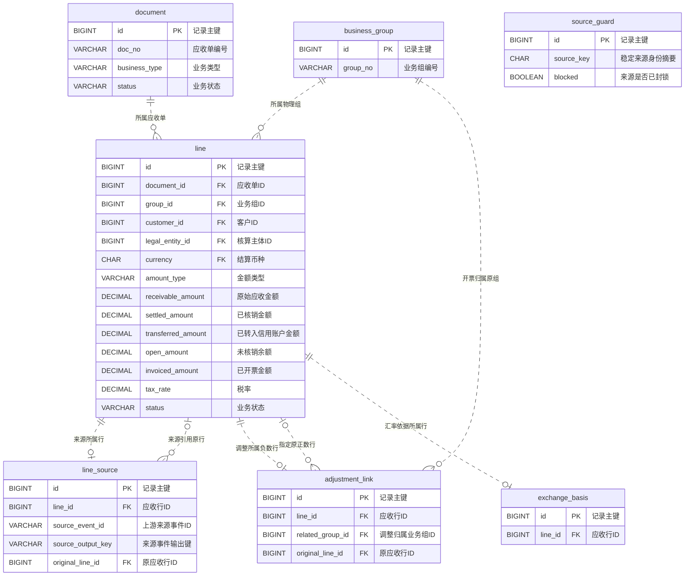
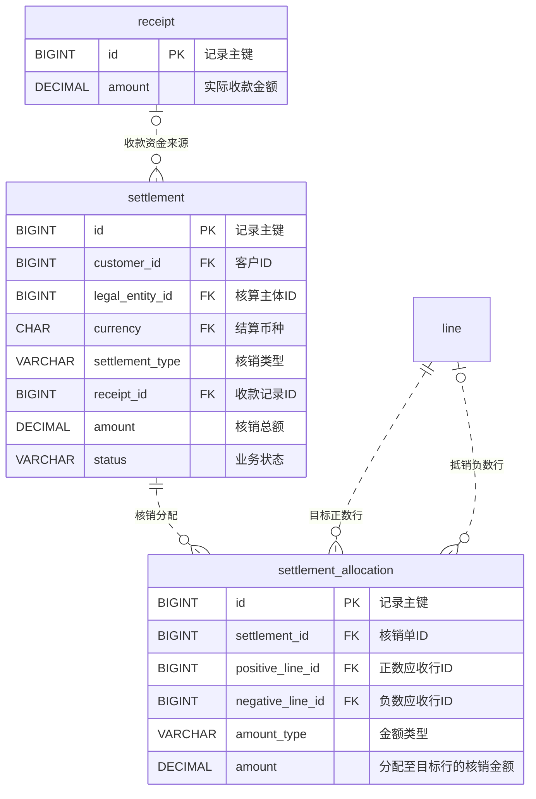
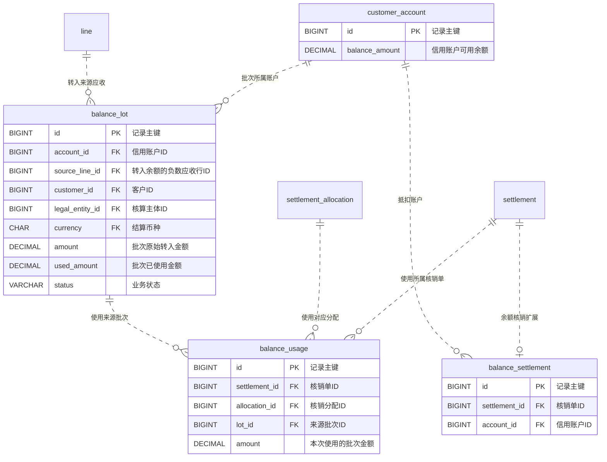
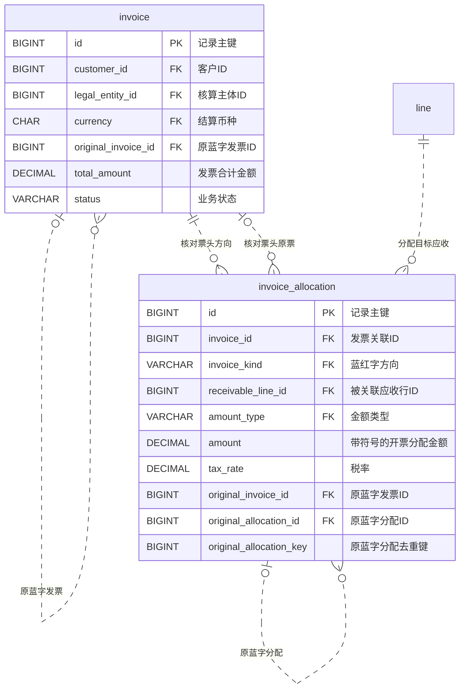
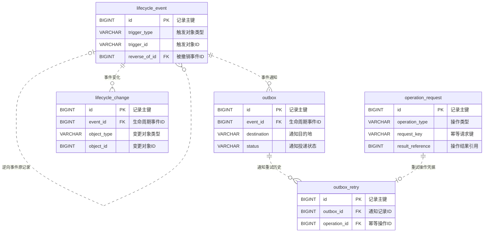
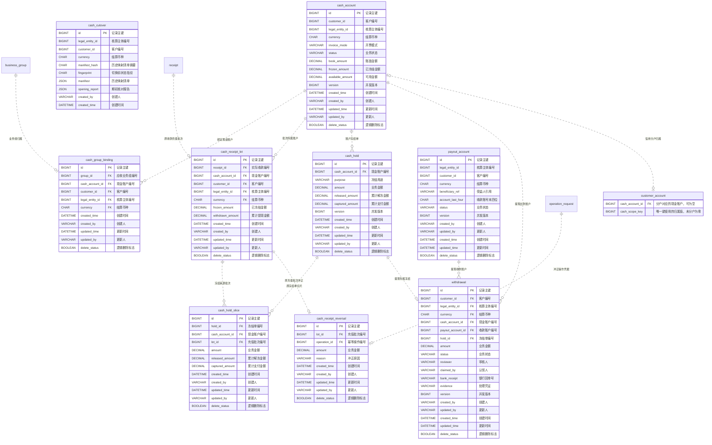

# 应收系统数据实体 ER 图

[手册目录](README.md) · [正式迁移 SQL](../../oms-ar-server/src/main/resources/db/migration)

以 V001–V021 的 30 张业务表、42 条物理外键为范围。图中省略表名前缀 `oms_ar_`。先看全景，再按业务查看主键、关联字段和复合外键的完整列序。

## 全景

每条连线从被引用表指向持有外键的表。左端表示一条子记录可引用的父记录数，右端表示一个父记录可被多少条子记录引用。`||` 表示恰好一个，圆圈表示允许为零，鸟爪表示多个。所有业务表使用独立自增主键，物理外键画为非标识关系（虚线）。基数按数据库约束绘制。

```mermaid
erDiagram
    document
    business_group
    line
    line_source
    operation_request
    lifecycle_event
    lifecycle_change
    receipt
    settlement
    settlement_allocation
    adjustment_link
    customer_account
    balance_lot
    balance_settlement
    balance_usage
    invoice
    invoice_allocation
    exchange_basis
    source_guard
    outbox
    outbox_retry
    document ||..o{ line : "所属应收单"
    business_group ||..o{ line : "所属物理组"
    line ||..o| line_source : "来源所属行"
    line o|..o{ line_source : "来源引用原行"
    lifecycle_event o|..o{ lifecycle_event : "逆向事件原记录"
    lifecycle_event ||..o{ lifecycle_change : "事件变化"
    receipt o|..o{ settlement : "收款资金来源"
    settlement ||..o{ settlement_allocation : "核销分配"
    line ||..o{ settlement_allocation : "目标正数行"
    line o|..o{ settlement_allocation : "抵销负数行"
    line ||..o| adjustment_link : "调整所属负数行"
    business_group ||..o{ adjustment_link : "开票归属原组"
    line o|..o{ adjustment_link : "指定原正数行"
    customer_account ||..o{ balance_lot : "批次所属账户"
    line ||..o{ balance_lot : "转入来源应收"
    settlement ||..o| balance_settlement : "余额核销扩展"
    customer_account ||..o{ balance_settlement : "抵扣账户"
    settlement ||..o{ balance_usage : "使用所属核销单"
    settlement_allocation ||..o{ balance_usage : "使用对应分配"
    balance_lot ||..o{ balance_usage : "使用来源批次"
    invoice o|..o{ invoice : "原蓝字发票"
    invoice ||..o{ invoice_allocation : "核对票头方向"
    invoice o|..o{ invoice_allocation : "核对票头原票"
    line ||..o{ invoice_allocation : "分配目标应收"
    invoice_allocation o|..o{ invoice_allocation : "原蓝字分配"
    line ||..o| exchange_basis : "汇率依据所属行"
    lifecycle_event ||..o{ outbox : "事件通知"
    outbox ||..o{ outbox_retry : "通知重试历史"
    operation_request ||..o| outbox_retry : "重试操作凭据"
    cash_account
    cash_group_binding
    cash_receipt_lot
    cash_hold
    cash_hold_slice
    payout_account
    withdrawal
    cash_receipt_reversal
    cash_cutover
    business_group ||..o| cash_group_binding : "业务组归属"
    cash_account ||..o{ cash_group_binding : "绑定现金账户"
    receipt ||..o| cash_receipt_lot : "原收款充值批次"
    cash_account ||..o{ cash_receipt_lot : "批次所属账户"
    cash_account ||..o{ cash_hold : "账户冻结单"
    cash_hold ||..o{ cash_hold_slice : "原冻结单切片"
    cash_receipt_lot ||..o{ cash_hold_slice : "冻结来源批次"
    cash_account ||..o{ withdrawal : "提现出款账户"
    payout_account ||..o{ withdrawal : "提现收款账户"
    cash_hold ||..o| withdrawal : "提现专属冻结"
    cash_account o|..o| customer_account : "信用分户归属"
    cash_receipt_lot ||..o| cash_receipt_reversal : "原充值批次冲正"
    operation_request ||..o| cash_receipt_reversal : "冲正操作凭据"
```

## 应收、来源与调整

每条应收行分别归属一张单据和一个业务组。调整关联同时指向负数行、原组和可选原行。来源锁通过主体与稳定来源身份匹配，可在应收生成前建立。

| 外键约束 | 子表引用列 | 父表匹配列 |
| --- | --- | --- |
| `fk_line_document` | `line(document_id,customer_id,legal_entity_id,currency)` | `document(id,customer_id,legal_entity_id,currency)` |
| `fk_line_group` | `line(group_id,customer_id,legal_entity_id,currency)` | `business_group(id,customer_id,legal_entity_id,currency)` |
| `fk_source_line` | `line_source(line_id)` | `line(id)` |
| `fk_source_original` | `line_source(original_line_id)` | `line(id)` |
| `fk_adjustment_line` | `adjustment_link(line_id)` | `line(id)` |
| `fk_adjustment_group` | `adjustment_link(related_group_id)` | `business_group(id)` |
| `fk_adjustment_original` | `adjustment_link(original_line_id)` | `line(id)` |
| `fk_exchange_line` | `exchange_basis(line_id)` | `line(id)` |

## 收款与核销

收款型核销通过单头引用收款。三类核销共用分配表，正数行是分配目标，负数行仅用于正负抵销。

| 外键约束 | 子表引用列 | 父表匹配列 |
| --- | --- | --- |
| `fk_settlement_receipt` | `settlement(receipt_id,customer_id,legal_entity_id,currency)` | `receipt(id,customer_id,legal_entity_id,currency)` |
| `fk_allocation_settlement` | `settlement_allocation(settlement_id)` | `settlement(id)` |
| `fk_allocation_positive` | `settlement_allocation(positive_line_id)` | `line(id)` |
| `fk_allocation_negative` | `settlement_allocation(negative_line_id)` | `line(id)` |

## 客户余额与批次

转入批次引用来源应收行。余额抵扣通过 balance_settlement 确定账户，balance_usage 将每条核销分配拆到实际使用的批次，反核销据此恢复原批次。

| 外键约束 | 子表引用列 | 父表匹配列 |
| --- | --- | --- |
| `fk_lot_account` | `balance_lot(account_id,customer_id,legal_entity_id,currency)` | `customer_account(id,customer_id,legal_entity_id,currency)` |
| `fk_lot_source` | `balance_lot(source_line_id)` | `line(id)` |
| `fk_bs_settlement` | `balance_settlement(settlement_id)` | `settlement(id)` |
| `fk_bs_account` | `balance_settlement(account_id)` | `customer_account(id)` |
| `fk_usage_settlement` | `balance_usage(settlement_id)` | `settlement(id)` |
| `fk_usage_allocation` | `balance_usage(allocation_id)` | `settlement_allocation(id)` |
| `fk_usage_lot` | `balance_usage(lot_id)` | `balance_lot(id)` |

## 蓝红字发票关联

红字头引用原蓝字头，红字分配引用原蓝字分配。同一发票头与分配间的两条约束分别核对方向和原票身份。蓝字的 original_invoice_id 为空时，第二条复合外键不参与匹配。

| 外键约束 | 子表引用列 | 父表匹配列 |
| --- | --- | --- |
| `fk_invoice_original_scope` | `invoice(original_invoice_id,customer_id,legal_entity_id,currency)` | `invoice(id,customer_id,legal_entity_id,currency)` |
| `fk_invoice_allocation_direction` | `invoice_allocation(invoice_id,invoice_kind)` | `invoice(id,invoice_kind)` |
| `fk_invoice_allocation_header_original` | `invoice_allocation(invoice_id,original_invoice_id)` | `invoice(id,original_invoice_id)` |
| `fk_invoice_allocation_receivable` | `invoice_allocation(receivable_line_id)` | `line(id)` |
| `fk_invoice_allocation_original` | `invoice_allocation(original_allocation_id,original_invoice_id,amount_type)` | `invoice_allocation(id,invoice_id,amount_type)` |

## 请求、审计与通知

逆向事件可追溯原事件。事件可以含零条变化，例如用新请求键重复作废已作废的应收。通知按事件和目的地唯一，人工重试同时引用通知和幂等请求。

| 外键约束 | 子表引用列 | 父表匹配列 |
| --- | --- | --- |
| `fk_event_reverse` | `lifecycle_event(reverse_of_id)` | `lifecycle_event(id)` |
| `fk_change_event` | `lifecycle_change(event_id)` | `lifecycle_event(id)` |
| `fk_outbox_event` | `outbox(event_id)` | `lifecycle_event(id)` |
| `fk_outbox_retry_outbox` | `outbox_retry(outbox_id)` | `outbox(id)` |
| `fk_outbox_retry_operation` | `outbox_retry(operation_id)` | `operation_request(id)` |

## 现金账户、冻结与提现

业务组和充值批次通过复合外键核对客户、主体及币种。冻结单记录总额，各切片记录具体占用的充值批次。提现单引用专属冻结单和收款账户。V018 为信用账户增加可空的现金归属，同一结算范围内按现金账户区分信用余额。冲正记录通过两个唯一键分别对应原批次和幂等操作。V020 按结算范围唯一保存切换清单和期初核对报告。

| 外键约束 | 子表引用列 | 父表匹配列 |
| --- | --- | --- |
| `fk_cash_binding_group` | `cash_group_binding(group_id,customer_id,legal_entity_id,currency)` | `business_group(id,customer_id,legal_entity_id,currency)` |
| `fk_cash_binding_account` | `cash_group_binding(cash_account_id,customer_id,legal_entity_id,currency)` | `cash_account(id,customer_id,legal_entity_id,currency)` |
| `fk_cash_lot_receipt` | `cash_receipt_lot(receipt_id,customer_id,legal_entity_id,currency)` | `receipt(id,customer_id,legal_entity_id,currency)` |
| `fk_cash_lot_account` | `cash_receipt_lot(cash_account_id,customer_id,legal_entity_id,currency)` | `cash_account(id,customer_id,legal_entity_id,currency)` |
| V016 未显式命名 | `cash_hold(cash_account_id)` | `cash_account(id)` |
| V016 未显式命名 | `cash_hold_slice(hold_id,cash_account_id)` | `cash_hold(id,cash_account_id)` |
| V016 未显式命名 | `cash_hold_slice(lot_id)` | `cash_receipt_lot(id)` |
| `fk_withdrawal_cash` | `withdrawal(cash_account_id,customer_id,legal_entity_id,currency)` | `cash_account(id,customer_id,legal_entity_id,currency)` |
| `fk_withdrawal_payout` | `withdrawal(payout_account_id,customer_id,legal_entity_id,currency)` | `payout_account(id,customer_id,legal_entity_id,currency)` |
| `fk_withdrawal_hold` | `withdrawal(hold_id,cash_account_id)` | `cash_hold(id,cash_account_id)` |
| `fk_credit_cash_scope` | `customer_account(cash_account_id,customer_id,legal_entity_id,currency)` | `cash_account(id,customer_id,legal_entity_id,currency)` |
| `fk_cash_reversal_lot` | `cash_receipt_reversal(lot_id)` | `cash_receipt_lot(id)` |
| `fk_cash_reversal_operation` | `cash_receipt_reversal(operation_id)` | `operation_request(id)` |

## 服务层维护的业务引用

| 保存位置 | 如何定位业务对象 |
| --- | --- |
| source_guard | 按主体和来源 system/type/id/lineId 数组的摘要锁定来源。行号为空代表单据级来源槽。多个价税输出可以共用一个槽。 |
| operation_request.result_reference | 根据 operation_type 解析结果，例如应收创建指向 document，核销确认指向 settlement，作废指向 lifecycle_event。 |
| lifecycle_change.object_type / object_id | 对象类型确定目标表，同一事件可记录单头、应收行、账户或批次等对象的变化。 |
| lifecycle_event.trigger_type / trigger_id | 依事件类型记录业务触发方，例如核销事件关联核销单，创建事件可记录请求键。 |
| 客户、主体、币种及外部来源 | customer_id、legal_entity_id、currency 共同限定结算范围。来源系统的单据 ID 和行 ID 标识外部记录。 |
