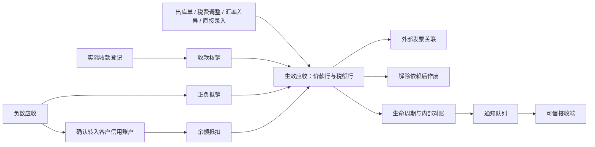

# 应收系统业务逻辑与开发说明手册

本手册面向业务负责人、财务、后端开发、测试及系统接入人员。核心应收章节源自 V012，当前接口、资金分户及部署验收已核对至 V020（实现提交 `97abad8`），数据库基线为 MySQL 8.0.42，Java 21。文档中的“当前实现”指本仓库实际代码，不代表已经接入银行、税务平台或完整用户身份系统。

## 阅读路径

| 章节 | 主要内容 | 建议读者 |
| --- | --- | --- |
| [业务功能与流程](01-business.md) | 术语、金额口径、创建、三类核销、余额、开票、作废、实例 | 业务、财务、开发、测试 |
| [代码架构与数据模型](02-development.md) | 分层、服务职责、核心应收21张表、事件、开发约束、扩展方法 | 开发、架构、测试 |
| [关键算法与事务并发](03-algorithms.md) | 分配、FIFO、额度、汇率、幂等、锁序、对账和通知算法 | 开发、架构、测试 |
| [接口接入与运维验证](04-integration-operations.md) | 接口清单、权限、请求示例、调用编排、启动、迁移、排障 | 接入开发、运维、测试 |
| [数据实体 ER 图册](05-entity-relationships.md) | 30 张表全景、六个业务分区及 42 条物理外键的列映射 | 开发、架构、测试 |

Mermaid 图使用标准 `flowchart`、`sequenceDiagram`、`stateDiagram-v2`、`erDiagram` 代码块。支持 Mermaid 的 Markdown 阅读器可直接渲染；不支持的阅读器仍可查看图源码和相邻文字说明。图中关系分为业务引用与数据库外键，ER 图不替代正式 DDL。

## 系统定位

系统采用“明细余额＋完整业务流水”：当前余额支持快速查询，业务单据及分配解释余额来源，生命周期快照解释前后变化。每个财务动作在同一数据库事务内更新余额、业务关系、幂等结果、审计和待通知事件。外部通知异步发送，不参与跨系统事务。

## 已实现与预留边界

- 当前核销策略为 `GROUP_TAX_FIRST`；`DOCUMENT_TAX_FIRST` 仅预留枚举，传入会被拒绝。
- 创建成功即生效、可核销，没有审核阶段；财务作废要求权限和原因，没有审批阶段。
- “开票”在本服务中是外部发票与应收的关联登记；撤销关联不等于税务平台作废。
- 信用账户来自负数应收转入，与实际收款余额分别维护；信用余额仅供抵扣；实际现金可按[现金账户手册](../cash-accounts.md)在原账户提现。
- 通知默认关闭；接收方需要持久化去重。没有严格一次或跨事件顺序保证。
- 当前交付为后端，前端用户确认通过预览、确认请求和版本/指纹契约表达；不包含操作页面。

## 文档与代码的关系

本手册解释业务与开发机制；[HTTP契约](../http-api.md)提供补充字段说明，[正式迁移](../../oms-ar-server/src/main/resources/db/migration)是数据库结构权威来源。历史方案中的拟定表名不作为实际表名使用。需求证据见[验收矩阵](../acceptance-matrix.md)，交付边界见[最终评审](../final-review.md)。

修改业务行为时，应同时更新对应章节、请求/响应说明、迁移及测试。不得仅改文档承诺尚未实现的功能。
